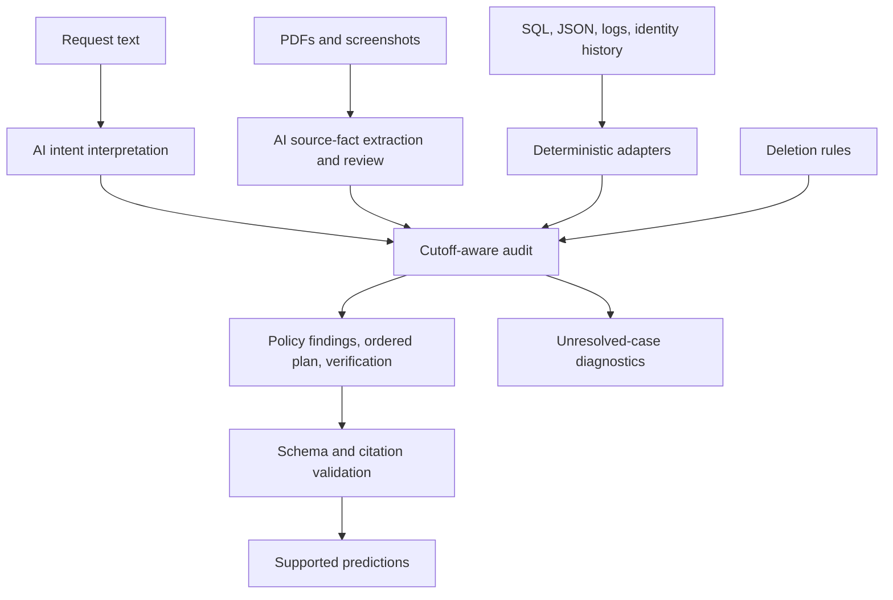

# Architecture and boundaries

The default strict pipeline below is preserved. `decision_policies.py` and
`compare_approaches.py` additionally compare conservative and evidence-based
prediction policies over the same original observations. The latter can publish
a full-schema prediction candidate with an external assumptions ledger, including
an explicitly inferred archive-risk forecast. Original states and provider
responses are unchanged. Read `evaluation/approach_comparison.md` before treating
that candidate as an audited fact or a guarantee of deletion completeness.

This is a bounded AI-assisted audit pipeline. AI interprets deletion intent and business media; deterministic Python reconstructs evidence, applies the supplied policy, and orders the plan. It writes proposed actions and checks, not changes to customer systems. It is not an open-ended autonomous tool loop.

The organizer screenshot supplied by the user recommends building an agent and considering scalability and robustness. It does not state a mandatory API requirement. This implementation uses Gemini because semantic request/media interpretation is useful here; the screenshot is not treated as an additional API rule.

## AI responsibilities

`model_client.py` batches up to 40 short requests to classify actual authorization across languages and negations. A request to verify a previous deletion is applicable; an export-only request is not. Workflow status and case IDs are not intent evidence.

Images are sent as PNG content. For PDFs, pypdf extracts every page; the text path is used only if every page has nonempty text and the combined text exceeds the current minimum length. Otherwise the PDF is sent as inline media. Text extraction can still lose layout or visual details in a text-bearing PDF; this is a limitation, not guaranteed OCR coverage.

An initial extraction identifies literal resources and facts. A separate source-fact review distinguishes stored direct identifiers, permitted stable references, search context, field visibility, scope, lifecycle dates and observed state. Neither prompt requests a deletion verdict or an output plan. Canonical catalog mappings are joined after review, rather than supplied as supposed printed media IDs. Business-alias extraction and narrowly bounded corrective review handle specific validation failures.

Structured schemas, semantic validation and source quotes constrain extraction, but they do not prove every visual fact was read correctly. Temperature zero does not guarantee identical new provider responses. Original genuine envelopes and attempt usage remain available locally; unsupported facts are never filled from public expected answers.

## Deterministic responsibilities

- `audit_core.py` resolves stable subjects through current and historical identifiers. It validates the exact output fields, numbering, operation/state combinations and eligible citations.
- `evidence.py` reads structured artifacts and produces observations with provenance, physical scope and time. SQL exports run in a restricted in-memory SQLite connection; there is no persistent SQL server. Media hydration validates source facts and records deterministic scope corrections without rewriting provider content.
- `reasoning.py` indexes identifiers and resources, follows explicit resource relationships, and selects eligible observations for each physical copy. Availability includes capture, observation and required catalog-link times. Later evidence cannot establish an earlier verdict.
- Policy reasoning preserves required retention and stable tombstone references, distinguishes stored PII from search inputs, and requires explicit restore/flow state. A complete negative scope can prove absence for a grounded owned key; it cannot invent a missing key.
- The planner reports supported violations, disables flows/blocks unsafe restores before dependent record changes, orders downstream dependencies, then serializes verification. It validates citations before publishing predictions.
- `main.py` orchestrates extraction and audit. A normal incomplete run preserves an existing output and exits 2; explicitly requested partial results contain only supported cases and also exit 2. Missing evidence remains in diagnostic records, not a fourth status or an invented `INCOMPLETE` answer.

The whole-account completion guard requires a deleted primary account or a compliant tombstone for an otherwise complete audit. This is a conservative implementation condition stricter than the literal contract. It does not prove exhaustive discovery. Removing it does not supply the missing owned account keys or verification citations in the reviewed blocked cases.

## Evaluation boundary

Only `evaluation/` reads public expected outputs or organizer-exclusion metadata. The predictor reads participant evidence and policy, never sample answers. Evaluation keeps all 32 public cases in primary accuracy denominators, including cases without predictions. Full-set coverage has no corresponding measured hidden accuracy.

The two confirmed exclusions change a separate evaluation view only. Prediction still attempts all 518 requests. The original 518-row CSV requirement and the schema's lack of an uncertainty status remain pending organizer clarification.

## Scalability and robustness

Implemented: shared parsing, batched intent calls, source-once media extraction, exact-request response caching, inverted identifier/resource indexes, explicit dependency graphs, cutoff-view reuse, sequential resumable requests, bounded retries and atomic response-cache publication. Offline replay amortizes model work and reproduces supported results. The 518-request run was actually exercised; no larger-load benchmark or production throughput claim is made.

Limits: artifacts and cached cutoff views reside in process memory; some matching and cache invalidation still scan global collections. There is no distributed queue, worker coordination, streaming large-file ingestion or cross-process cache lock. Use one producer per cache directory. A failed required media review can hold otherwise unrelated deletion cases because the current discovery stage requires all media ready. This favors conservative coverage over throughput. Free-tier quota and provider latency bound a fresh run independently of local audit speed.

Possible improvements, not implemented: incremental persistent indexes, per-subject media readiness, bounded worker concurrency with shared quota scheduling, stronger visual cross-checks, and a documented abstention contract. None is claimed to resolve missing participant evidence or authorize a guessed resource key.
